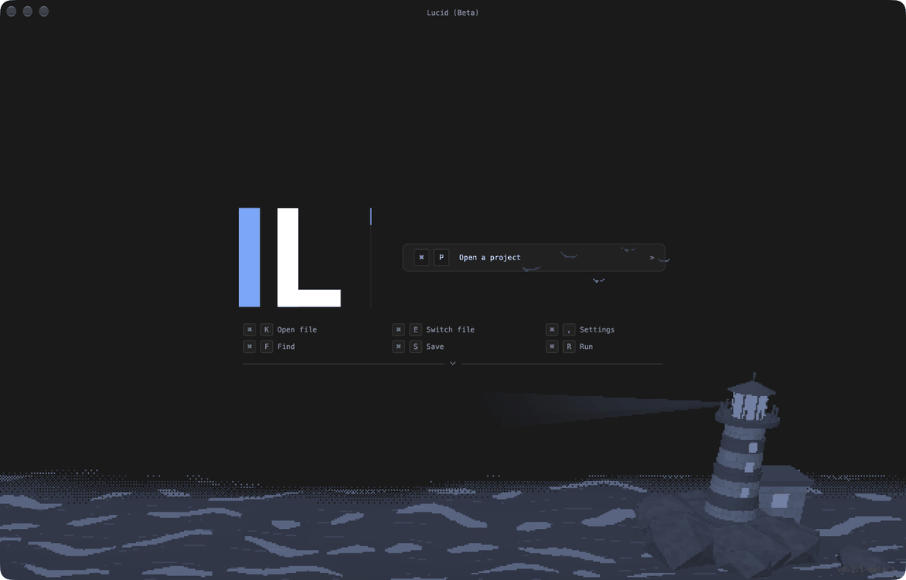
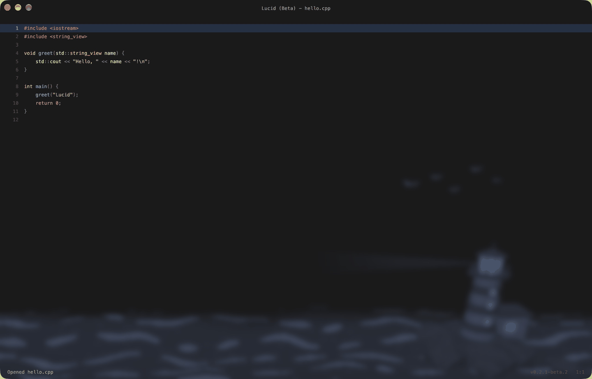

<div align="center">

<picture>
  <source media="(prefers-color-scheme: dark)" srcset="assets/branding/lucid-dark.svg">
  <source media="(prefers-color-scheme: light)" srcset="assets/branding/lucid-light.svg">
  
</picture>

# Lucid (Beta)

**A minimal, GPU-accelerated code editor built on Vulkan.**

Keyboard-first. Path-native. Drawn entirely on the GPU.

[](https://github.com/initializeddd/Lucid/actions/workflows/ci.yml)
[](#downloads)
[](LICENSE)
[](https://github.com/initializeddd/Lucid/releases)

[Download](#downloads) · [Docs](https://initializeddd.github.io/Lucid/) · [Getting started](docs/getting-started.md) · [Build from source](#build-from-source) · [Roadmap](docs/roadmap.md) · [Contributing](CONTRIBUTING.md) · [Discussions](https://github.com/initializeddd/Lucid/discussions)

</div>

---

Lucid is a keyboard-first editor built around paths instead of a file tree. Projects, files and
folders are opened or created by typing where they live, so the workspace stays on the canvas and
out of your way. New projects default to `~/Documents/Lucid`, keeping them separate from other apps.

The window, text, chrome and overlays are all rendered by a small Vulkan renderer. On macOS it runs
on MoltenVK; on Windows and Linux it uses the native Vulkan loader.

> **Beta software.** Features are at different stages of maturity, and file formats and behavior
> may change. This README describes the current source tree; the downloadable
> `v0.2.1-beta.2` release may differ. See the [changelog](CHANGELOG.md) and [roadmap](docs/roadmap.md).

## Lucid in action

**Welcome screen**



**Editing a file**



These short, sampled animations show the lighthouse scene in the welcome screen and editor.

## At a glance

- **A focused workspace** — open projects and files by path, and switch between open files without a permanent tab bar.
- **A GPU-rendered interface** — Vulkan on Windows and Linux, and MoltenVK on macOS.
- **Everyday editing** — UTF-8 text, undo/redo, find and replace, syntax highlighting, and C/C++ and JSON diagnostics.
- **Project search** — use Ctrl+Shift+F (Command+Shift+F on macOS) to search project files and review replacements before applying them.
- **Comment-driven builds** — define and run project commands alongside the code that describes them.
- **Optional local AI** — review a suggestion before applying it; the model is downloaded and verified on first use.
- **Work in context** — task workspaces, Git review, recovery snapshots, and opt-in modules bring project work into temporary surfaces.

### Feature maturity

| Area | Status in this working tree |
| --- | --- |
| Editing, open-file switcher, settings | Available; keyboard-first workflows are still evolving |
| Local AI and code cleanup | Preview; small selections, local inference and explicit acceptance |
| Git review | File-level staging, local commits and reviewed upstream operations; the optional Pull-Request Companion supports a bounded GitHub review workflow |
| Task workspaces and recovery | Local previews; recovery has [known limits](#recovery-snapshots) |
| Modules | Declarative manifests invoke supported Lucid actions; the 30 new module packages are not yet published. See [module guide](docs/modules.md) for access and limitations |
| Language intelligence | C/C++ through installed clangd, including reviewed rename; automatic server installation is not yet supported |
| Debugger | LLDB-based C/C++ workflow; macOS tested, Linux and Windows require platform validation |
| Multiplayer | Not yet available |
| Screen readers | Initial macOS bridge; broader accessibility work remains |

## Platform support

| | macOS | Linux | Windows |
| --- | :---: | :---: | :---: |
| Build | ✅ | ✅ | ✅ |
| Vulkan backend | MoltenVK | Vulkan loader | Vulkan loader |
| Native bundle / installer files | `.app` + ICNS | `.desktop` + PNG | `.exe` + ICO |
| Path Lens, editing, diagnostics | ✅ | ✅ | ✅ |
| Compile-function PTY terminal | ✅ | ✅ | Planned |
| Native destructive-action dialogs | ✅ | Planned | ✅ |
| Theme follows system caption bar | ✅ | — | ✅ (Windows 11) |

## Downloads

Download [Lucid v0.2.1-beta.2](https://github.com/initializeddd/Lucid/releases/tag/v0.2.1-beta.2), or browse all [releases](https://github.com/initializeddd/Lucid/releases).

| Platform | Artifacts | Notes |
| --- | --- | --- |
| macOS | DMG and standalone ZIP | Ad-hoc signed, not notarized |
| Linux | Standalone archive and installer script | A working Vulkan driver is required |
| Windows | MSI and standalone ZIP | MSI requires administrator access; debugger integration is not yet validated |
| FreeBSD and OpenBSD | Standalone archives | Native tests pass; GLFW, Vulkan and system crypto libraries must be installed separately |

The macOS build and local automated tests have been exercised on macOS 27.0.1.

The release includes SHA-256 checksums. Beta builds are not signed with distribution certificates,
so macOS Gatekeeper and Windows SmartScreen may warn on first launch. BSD builds have not had a
full graphical desktop smoke test.

The installer script supports Linux, FreeBSD and OpenBSD and downloads the matching release
archive. Installers register Lucid as an **Open With** option for supported text and source files
without changing the default application.

### Project-wide search and replace

Press Ctrl+Shift+F (Command+Shift+F on macOS), enter a literal, case-sensitive search and press Enter. Select a result to open its file, or select **Replace all matches** to enter replacement text and review the affected files before applying it. Ctrl+Shift+H also starts the workflow on Linux and Windows.

Search uses the project index and skips binary and unsupported text files. Select **Skipped files** in the results to review paths and reasons; the list is bounded and reports if further details were omitted. It currently uses fixed project exclusions rather than `.gitignore`. Replacement is disabled if a selected file could not be read or if the result or memory limit is reached; fix the file or exclude its path and search again. Files are checked for external changes before and during replacement. Replacements across files are not one undoable transaction: if a later write fails, earlier files may already have changed; use version control to review or revert them.

## Requirements

| Requirement | Minimum | Notes |
| --- | --- | --- |
| CMake | 3.24 | Presets require CMake 3.24+ |
| C++ compiler | C++20 | Apple Clang, GCC, Clang or MSVC |
| GLFW | 3.3 | Fetched automatically when missing |
| Vulkan | 1.2 | Headers, loader and a working ICD |
| `glslangValidator` | — | Ships with the Vulkan SDK |

### FreeBSD and OpenBSD (work in progress)

The previous release produced native x86-64 BSD archives and passed automated
VM tests. A full graphical desktop smoke test remains outstanding. Extract an
archive and run `./lucid`; the release installer script also supports BSD, but
its automatic downloads require public release assets.

BSD builds use system libraries rather than the Linux library bundle. Install
GLFW, the Vulkan loader and a suitable Vulkan driver through the operating
system's package manager. Local compilation additionally needs CMake, Ninja,
Git, Vulkan headers, glslang, and an SSL development library. Use the native
`pkg` on FreeBSD and `pkg_add` on OpenBSD. Secure OpenRouter key storage requires
`secret-tool` and an unlocked desktop Secret Service keyring. Native BSD packages
and full desktop, GPU, debugger, and installer validation are still outstanding.

## Build from source

Clone the repository, then follow the section for your platform. All commands are run from the
repository root.

```sh
git clone https://github.com/initializeddd/Lucid.git
cd Lucid
```

### macOS

Install the toolchain and libraries with [Homebrew](https://brew.sh):

```sh
xcode-select --install
brew install cmake ninja glfw glslang molten-vk vulkan-loader vulkan-headers
```

Configure, build and launch the app bundle:

```sh
cmake --preset debug
cmake --build --preset debug
open build/debug/bin/Lucid.app
```

For an optimized build, swap `debug` for `release`:

```sh
cmake --preset release
cmake --build --preset release
open build/release/bin/Lucid.app
```

Install it into `/Applications` (the install step re-signs the bundle after copying):

```sh
cmake --install build/release --prefix /Applications
```

A LunarG Vulkan SDK also works and is discovered automatically under `~/VulkanSDK/*` when
`VULKAN_SDK` is not set. If the loader cannot find MoltenVK at runtime:

```sh
export VK_ICD_FILENAMES=/opt/homebrew/share/vulkan/icd.d/MoltenVK_icd.json
```

### Linux

Install a compiler, CMake, Ninja, GLFW, the Vulkan loader and headers, and `glslang`:

```sh
# Debian / Ubuntu
sudo apt install build-essential cmake ninja-build libglfw3-dev libvulkan-dev \
    vulkan-tools glslang-tools libx11-dev libxrandr-dev libxinerama-dev \
    libxcursor-dev libxi-dev libwayland-dev libxkbcommon-dev
```

```sh
# Fedora
sudo dnf install gcc-c++ cmake ninja-build glfw-devel vulkan-loader-devel \
    vulkan-tools glslang libXrandr-devel libXinerama-devel libXcursor-devel \
    libXi-devel wayland-devel libxkbcommon-devel
```

```sh
# Arch
sudo pacman -S --needed base-devel cmake ninja glfw vulkan-headers \
    vulkan-icd-loader vulkan-tools glslang libxrandr libxinerama libxcursor \
    libxi wayland libxkbcommon
```

Configure, build, test and run:

```sh
cmake -S . -B build -G Ninja -DCMAKE_BUILD_TYPE=Release
cmake --build build
ctest --test-dir build --output-on-failure
./build/bin/lucid
```

Install the executable, desktop entry and icon into your local prefix:

```sh
cmake --install build --prefix ~/.local
```

### Windows

Install the following, then open **x64 Native Tools Command Prompt for VS 2022**:

- **Visual Studio 2022** with the *Desktop development with C++* workload
- **CMake 3.24+** (bundled with Visual Studio, or `winget install Kitware.CMake`)
- **Vulkan SDK 1.2+** from LunarG, or `winget install KhronosGroup.VulkanSDK`

The SDK provides the loader, headers and `glslangValidator`. GLFW is fetched automatically when a
system installation is not found.

```powershell
cmake -S . -B build -G "Visual Studio 17 2022" -A x64
cmake --build build --config Release
ctest --test-dir build -C Release --output-on-failure
.\build\bin\Lucid.exe
```

The executable embeds `packaging/windows/lucid.ico`. On Windows 11, Lucid applies a dark caption,
text and border color through DWM while keeping the standard window controls.

> Compile functions and their PTY terminals run on macOS, Linux and BSD. On Windows the
> platform layer reports that the terminal is unavailable.

### Build options

| Option | Default | Description |
| --- | --- | --- |
| `LUCID_ENABLE_VALIDATION` | `ON` | Enable `VK_LAYER_KHRONOS_validation` in Debug builds |
| `LUCID_WARNINGS_AS_ERRORS` | `OFF` | Promote compiler warnings to errors |
| `LUCID_BUILD_TESTS` | `ON` | Build the test suite |

Pass them with `-D<OPTION>=<VALUE>` at configure time, for example:

```sh
cmake -S . -B build -G Ninja -DCMAKE_BUILD_TYPE=Release -DLUCID_WARNINGS_AS_ERRORS=ON
```

See [Building](docs/building.md) for signing, packaging, icon regeneration and validation notes.

## Settings

`Ctrl+,` opens the settings page. **Edit settings...** opens the `Settings` project; the file lives at:

| Platform | Path |
| --- | --- |
| macOS | `~/Library/Application Support/Lucid/Settings/settings.json` |
| Windows | `%APPDATA%\Lucid\Settings\settings.json` |
| Linux | `$XDG_CONFIG_HOME/Lucid/Settings/settings.json` or `~/.config/Lucid/Settings/settings.json` |

```json
{
    "animationSpeed": 1.0,
    "showSyntaxErrors": true,
    "showLineNumbers": true,
    "highlightCurrentLine": true,
    "cursorBlink": true,
    "cursorStyle": "line",
    "backgroundMotion": true,
    "backgroundScene": 0,
    "highContrast": false,
    "zoomFactor": 1.0,
    "iconTheme": "classic",
    "theme": "lucid-dark",
    "primary": "#787eff"
}
```

`animationSpeed` accepts `0.5`, `1.0` or `2.0`. `cursorStyle` accepts `line`, `block`,
`underscore` or `kitty` (`bar` and `underline` remain accepted as aliases). `backgroundMotion`
enables or disables the animated 3D background. Choose a scene under **Settings → Animation →
Background scene**. **Background colors** switches between the primary-color tint and each scene's own colors. Scenes dim and blur while a file is open to keep code readable. The bundled scenes
are rendered locally and do not require an image download. In `settings.json`, `backgroundScene`
uses IDs `0`, `1`, `2`, `4`, `6`, and `7`: city transit, lunar horizon, mountain parallax,
ocean lighthouse, orbital station, and forest fireflies. Removed scene IDs `3`, `5`, `8`, and `9`
fall back to city transit. If the 3D renderer or its assets are unavailable, Lucid leaves the background
clear and logs the error. `zoomFactor` accepts `0.5` through `3.0` and scales
the whole interface, including text, layout and mouse hit testing. `theme` accepts `lucid-dark`,
`graphite` or `lucid-light`. `primary` accepts any `#RRGGBB` color and overrides the theme accent and
selection tint; omit it to use the theme default. The settings menu includes primary color swatches
for quick changes. In settings, use Tab or arrow keys to move between controls and Enter or Space
to activate them. `iconTheme` accepts `classic`, `accent` or `outline`; the running application's
Dock or window icon uses the active primary color. The installed file icon remains the bundled
icon. The size control scales both text and the rest of the interface.

Settings apply live while the file is edited; `Ctrl+S` persists them. Invalid settings leave the last
valid configuration active and show a red error in the top-right corner; click it to reopen
`settings.json`.

## Keyboard shortcuts

Shortcuts are written for Windows and Linux. On macOS, use Command in place of `Ctrl` and Option
in place of `Alt`:

| Windows / Linux | macOS |
| --- | --- |
| `Ctrl` | Command |
| `Alt` | Option |

| Action | Shortcut |
| --- | --- |
| Open or create a project | `Ctrl+P` / `Ctrl+O` |
| Open or create a file by path | `Ctrl+K` / `Ctrl+N` |
| Switch between open files | `Ctrl+E` |
| Close selected file in switcher | `Ctrl+W` while the switcher is open |
| Reopen last closed file | `Ctrl+Shift+E` |
| Complete the selected suggestion | `Tab` |
| Find in the current file | `Ctrl+F` |
| Replace a match | `Ctrl+H` (macOS: `Command+Option+F`) |
| Show function suggestions at the cursor | `Ctrl+Shift+Space` |
| Ask local AI about selected code | `Ctrl+Shift+A` |
| Clean up selected code with local AI | `Ctrl+Shift+L` |
| Open task workspaces / Git review / modules | `Ctrl+Shift+T` / `Ctrl+Shift+G` / `Ctrl+Shift+M` |
| Review recovery snapshots | `Ctrl+Shift+Y` |
| Increase / decrease / reset UI and text size | `Ctrl+=` / `Ctrl+-` / `Ctrl+0` |
| Toggle high contrast | `Ctrl+Shift+U` |
| Create the typed folder and keep the prompt open | `Ctrl+Enter` |
| Dismiss the Path Lens | `Escape` |
| Save | `Ctrl+S` |
| Close file (saves first) | `Ctrl+W` |
| Delete line | `Ctrl+Shift+K` |
| Delete previous / next word | `Ctrl+Backspace` / `Ctrl+Delete` (macOS: Option+Backspace / Option+Delete) |
| Insert line below / above | `Ctrl+Enter` / `Ctrl+Shift+Enter` |
| Toggle line comment | `Ctrl+/` |
| Toggle block comment on the selection or current line | `Alt+Shift+A` (macOS: `Option+Shift+A`) |
| Indent / outdent selection | `Tab` / `Shift+Tab` |
| Move current line | `Alt+Up` / `Alt+Down` |
| Beginning / end of document | `Ctrl+Home` / `Ctrl+End` (macOS: Command+Up / Command+Down); add Shift to select |
| Previous / next paragraph | `Ctrl+Up` / `Ctrl+Down` (macOS: Command+Option+Up / Down); add Shift to select |
| Undo / redo | `Ctrl+Z` / `Ctrl+Shift+Z` / `Ctrl+Y` |
| Run compile function under caret | `Ctrl+R` |
| Search project compile functions | `Ctrl+Shift+R` |
| Open settings | `Ctrl+,` |
| Select all / copy / cut / paste | `Ctrl+A` / `Ctrl+C` / `Ctrl+X` / `Ctrl+V` |
| Duplicate line | `Ctrl+D` |
| Join lines | `Ctrl+J` |
| Delete file / project | `Ctrl+Shift+Backspace` / `Ctrl+Shift+Alt+Backspace` |

Block commenting supports common C-style and HTML/XML delimiters. Lucid refuses
ambiguous selections containing additional comment delimiters; it does not yet
analyze whether a selection is already inside a string or comment.

Use `Ctrl+E` (Command+E on macOS) to open a temporary list of open files. Opening another
file saves the current file as before; returning to an unchanged file restores its cursor, scroll
position and undo history. If a clean file changed on disk while inactive, Lucid reloads it.
For a dirty inactive file, Lucid retains the unsaved buffer and blocks saving if the disk
version changed. It can reopen the buffer even if the file is missing or has become binary;
use Recovery to preserve a copy before resolving the conflict.
Recovery will not replace another open buffer with unsaved edits. Its **Restore as a
new file** action can also preserve a snapshot when the original path is now a folder.
If the disk file is missing, unreadable, or binary, recovery opens the saved text
without opening the disk file in an external application; saving still checks the
original baseline.
Closing the current file returns to the most recently active open file.

Find searches case-sensitive text in the open file; Enter and Shift+Enter move through matches.
In project search, Ctrl+Shift+W (Command+Shift+W on macOS) toggles whole-word matching.
Ctrl+Shift+C (Command+Shift+C on macOS) toggles ASCII case-insensitive matching.
Ctrl+Shift+I (Command+Shift+I on macOS) includes or excludes generated directories such as
`build` and `node_modules`; version-control and Lucid internal directories remain excluded.
Ctrl+Shift+G (Command+Shift+G on macOS) edits a case-sensitive path filter, which also
limits replacements. Separate alternatives with commas; plain text matches anywhere in
the path, `*` matches any number of path characters, `?` matches one byte, and `!`
excludes a pattern. For example, `*.cpp, *.hpp, !vendor/` searches those extensions
outside paths containing `vendor/`. Leave the filter empty to search all indexed files.
Replacement applies only the matches shown in the search results.
In replacement review, open a file and press Enter on a match to include or exclude it.
Ctrl+Up/Down (Command+Up/Down on macOS) recalls project searches from the current session.
Ctrl+Shift+O (Command+Shift+O on macOS) returns to the last project-search results.
Replace opens a find prompt, then Enter opens the replacement prompt. Enter replaces the selected
match (an empty replacement deletes it), and returns to the find prompt. Escape closes the prompt;
replacements can be undone normally.
Undo history is bounded by both the number and memory size of stored snapshots; older
steps may be discarded sooner for large files. Local recovery history is separate.

### Language intelligence

For C and C++ projects Lucid starts `clangd` from your PATH, if available, to provide diagnostics
and supported completion suggestions. Install LLVM/clangd separately and provide a
`compile_commands.json` for the most accurate project results. Use Ctrl+Shift+Space
(Command+Shift+Space on macOS) to open completion, F12 to find a definition, Ctrl+F12
(Command+F12 on macOS) to find a declaration when supported, Shift+F12 to
find references, and Alt+Shift+F (Option+Shift+F on macOS) to format the current buffer
or the selected range when text is selected.
Alt+Shift+S (Option+Shift+S on macOS) requests function signatures and identifies the
active parameter when the server supplies that information.
Alt+Shift+O (Option+Shift+O on macOS) searches project symbols through clangd's index.
F4 searches symbols in the current file, including nested symbols. Its name filter
ignores ASCII case; results are limited to 500 locations.
F2 requests a symbol rename and opens a review of the affected files. Select a file to inspect
its individual changes; unusually long change previews are shortened. The language server may
not find every project reference, so inspect the resulting changes. Applying a rename writes the reviewed files after conflict
checks and recovery backups; a failure can leave earlier files changed.
Cross-file results depend on clangd's project index and compilation database.
F8 and Shift+F8 move to the next or previous diagnostic in the current file;
Ctrl+F8 (Command+F8 on macOS) opens the diagnostic list.
Ctrl+Shift+I (Command+Shift+I on macOS) opens language-server status, where clangd
can be started or restarted and its advertised capabilities can be inspected.
For a CMake project with no existing `build/` directory, that view can generate a
compilation database by configuring a new `build/`; this runs the project's CMake
scripts and displays their output in the compile window. Windows users currently
need to configure CMake separately. Existing build directories are not modified.
Navigation currently opens locations inside the project only. Formatting can be undone and
does not save the file automatically. When clangd is unavailable, completion falls back to
function names found in the current file and a bounded scan of project files. Automatic
language-server installation and languages beyond C/C++ are not yet supported.

Local AI runs inside Lucid without a separate model server. On its first request Lucid downloads
approximately 491 MB from Hugging Face and verifies the pinned model's SHA-256 before loading it.
Select code, press `Ctrl+Shift+A`, and describe a small task. The current diagnostic is included
when available. Scroll the response with Up/Down, press Enter to replace the selection with it,
or Escape to dismiss it. AI output is a suggestion and may contain mistakes or Markdown; review it
before inserting. Requests and selected code run locally. The bundled inference engine is
[llama.cpp](https://github.com/ggml-org/llama.cpp), and the model is
[Qwen2.5-Coder-0.5B-Instruct-GGUF](https://huggingface.co/Qwen/Qwen2.5-Coder-0.5B-Instruct-GGUF).

Arrows, `Home` and `End` move the caret; hold `Shift` to extend the selection. Click a line to place
the caret, drag to select, and `Shift`-click to extend. Scroll to move the viewport. Click anywhere
outside the Path Lens to dismiss it.

Suggestions ending in `/` are folders: press `Enter` or `Tab` to step into one. A trailing slash also
creates a folder, so `src/components/` followed by `Enter` makes the directory. Creating
`src/components/Button.cpp` creates both folders automatically.

## Accessibility

Use **Command/Ctrl + =** and **Command/Ctrl + -** to change the interface and
text size, or **Command/Ctrl + 0** to reset it. **Command/Ctrl + Shift + U**
toggles a monochrome high-contrast mode. These settings persist locally. Errors
also carry a text label. The settings page and temporary command views support
keyboard navigation.

On macOS, the editor exposes its text and selection, and command views expose
their visible options, through the native accessibility API. This is an initial
bridge: full VoiceOver editing and navigation, complete semantic controls, and
Windows and Linux screen-reader integration are not implemented yet.

## Sessions and recovery

Lucid saves recent projects and, on a clean exit, the active project and open
file positions. On the next launch, choose whether to restore that workspace or
start fresh. Select **Don't show again** before choosing to remember that action;
change it later under **Settings → Editor → Startup session**. Restoring skips missing or
unsupported files. An explicit file supplied at launch takes
precedence. If crash snapshots are available, Lucid presents recovery instead
of automatically reopening the saved file context. Session records contain
paths and positions, not unsaved text or undo history.

Project file scans and compile-function indexing run in the background. The
file picker waits for the current scan before offering paths.

## Recovery snapshots

While a project and file are open, Lucid keeps a local recovery snapshot about
once per second. It contains the open file's text, its last known disk version,
cursor position, and the other open file paths and cursor positions. After an
unclean exit, open the same project to review snapshots, or use **Run > Recovery**
on macOS / **Command+Shift+Y** (Ctrl+Shift+Y on Windows/Linux). The review view
shows file names and snapshot text before restoring. Restoration opens the saved
text in the editor; it does not write the recovered text to disk automatically.

If the disk file has changed or disappeared since the snapshot, Lucid blocks a
normal save and keeps the recovered text open so you can copy it. Recovery records
are stored locally in Lucid's `Recovery` directory, contain plain text, and remain
until explicitly deleted in the recovery view. A clean exit removes the current
session's snapshot. Snapshots are periodic, limited to 16 MiB per file, and do
not preserve undo history; edits made after the last successful snapshot may be
lost. Concurrent changes between the disk check and the write are not prevented.

Before saving an edited file, Lucid keeps up to three previous saved versions in
its local Recovery/History directory. Project-wide replacement also backs up each
affected file before making changes. Open Recovery to review a version and use
**Restore as a new file** to keep the current file untouched. If the backup
cannot be written, Lucid stops the save or replacement. Backups contain the file
contents in plain text and consume disk space; deletion through the Recovery
interface is not yet available on every platform.

On Linux and macOS, saves preserve supported extended attributes and permissions;
Lucid refuses to replace a hard-linked file rather than silently breaking its
links. Other filesystem metadata and platform-specific behavior still require
validation. No editor can guarantee protection against every power, storage,
filesystem or concurrent-write failure; keep independent backups.

## Modules

Lucid's module manager uses declarative manifests in a temporary, keyboard-accessible
surface. Preview a local manifest or supported GitHub package before installing it;
modules show their requested project, network, process, settings and device access
and start disabled. Supported commands include snippets and Lucid-provided tools;
there is no arbitrary-code module runtime. Some actions run programs with your
privileges, and network actions ask for confirmation. The 30 new module packages
are not published yet; the existing public catalog does not contain them. See the
[module guide](docs/modules.md) for commands, permissions and limitations.

## AI settings

Open **Settings > AI settings** to choose **Local** or **OpenRouter** independently
for Ask AI, code cleanup, and debugger explanations. Local uses the bundled
Qwen2.5 Coder 0.5B integration and downloads the model on first use. For each
OpenRouter workflow, enter its model ID (for example `provider/model`) and use
**Set or change OpenRouter API key**. The key is stored in macOS Keychain,
Windows Credential Manager, or the Linux desktop keyring through `secret-tool`;
Linux and BSD require the helper and an unlocked Secret Service keyring. The key is
not written to the settings file. You can remove it in the same menu.

OpenRouter requests send the prompt and relevant selected code, surrounding
context, diagnostics, or debugger state to the provider. Lucid identifies this
before you press Enter. OpenRouter and model providers may charge for usage.

## Clean up code with AI

Select a short section of code, then choose **Edit > Clean Up Selection with
AI** on macOS or press **Command+Shift+L** (Ctrl+Shift+L on Windows/Linux).
Press Enter to generate a rewrite, inspect the preview, and press Enter to apply
it or Escape to discard it. Lucid includes nearby lines as style references and
asks the model to preserve behavior. With the local provider, the model is downloaded on first use and code is processed on the device. The selection is limited to 1200 bytes, and
long or incomplete responses are rejected. Review the result and run your tests:
the model cannot guarantee behavior is unchanged.

## Git review

With a Git project open, choose **Run > Git Review** on macOS or press
**Command+Shift+G** (Ctrl+Shift+G on Windows/Linux). Lucid lists changed and
untracked files and marks merge conflicts. Select a file to view its staged and
working-tree diffs, stage or unstage it, or open it for editing. Select a diff
line to jump to its source; Git blame identifies committed and uncommitted lines.

To resolve a conflict, edit the file, remove the conflict markers, then choose
**Mark resolved and stage**. From the file list, choose **Review staged changes
and commit** to inspect the staged paths and enter a message. Lucid creates a
local commit; it does not automatically push. If the index or HEAD changes during review, Lucid
asks you to review again. When a subfolder is open as the project, committing is
blocked if the index includes paths outside it; open the repository root instead.

Git must be installed locally. Git hooks and configured signing run as they do
for a normal commit and may reject it. The open file is saved before review, and
Git output is limited to 2 MiB. The Git menu also offers recent commits and
reviewed fetch, pull and push operations for the current branch's configured
upstream. Pull requires a clean working tree and only permits fast-forward
updates; push targets the reviewed commit and never force-pushes. Remote
operations run without interactive credential prompts; SSH uses batch mode,
so credentials must already be available. An SSH command configured in the
environment or Git configuration is not used for these operations. Staging
individual hunks, branch creation/deletion and pull-request metadata are not yet
implemented. **Local branches** lets you review and switch an existing branch when
the entire repository and open buffers are clean. Git may run checkout hooks.
Open files are refreshed; files missing from the new branch remain open as
recoverable text. The Windows implementation requires validation on Windows.

## Task workspaces

Open **Run > Tasks** on macOS or press **Command+Shift+T** (Ctrl+Shift+T on
other platforms) with a project open. Set a display name, create a task, and choose
one of three tiers: optional polish, quality-of-life work, or urgent bugs and security.
The task menu supports subtasks, assignment, working status, completion, a written
solution, and an activity history. Open a task workspace to restore its recorded
files and cursor positions. Use the page controls in the menu to reach more actions.

Tasks are stored in `.lucid/tasks.json` in the project. Names are user-entered
labels, not verified identities. The task file detects changes made since it was
loaded, but it is not a live collaboration service or a substitute for conflict
resolution. Save and coordinate changes when sharing the project. The active task
stores its selected debug executable, source and breakpoints, and records debug starts.

## Debugging

For C/C++ programs on macOS, build the executable with debug symbols (for example,
`-g -O0`), open its source file, and use **Command+Shift+B** to toggle a
breakpoint on the current line. Open **Run > Debugger** with **Command+Shift+D**,
choose **Start debugging**, enter the executable's path relative to the
project, then enter arguments as a JSON array of strings (or accept `[]` for none)
and a working directory relative to the project (`.` uses the project root).
Finally, provide environment overrides as a JSON object of strings, or accept
`{}` to use the inherited environment.
The executable must already exist and contain debug information. On macOS,
Lucid uses `xcrun lldb-dap` from the Xcode toolchain. On Linux, install LLVM's
`lldb-dap` (versioned executable names are also searched). On Windows, install
LLVM with `lldb-dap.exe` on `PATH` or in `Program Files/LLVM/bin`. Lucid does
not install the adapter automatically. Linux and Windows need native validation.

While a program is running, choose **Pause** in the debugger menu to request a
stop. While stopped, the debugger menu offers continue, step over, step into, step out,
a call stack, thread selection, expandable variables, and output. A `B` marks a breakpoint, `>`
marks the stopped line, and an asterisk marks a variable that changed after a
step. Selecting a stack frame changes the displayed variables. The current
implementation can send breakpoints for multiple source files during a session.
Task workspaces currently persist only one source file's breakpoints. The debugger
does not yet provide attach, and thread behavior depends on the debug adapter. Breakpoints are line-based and do not automatically
move with edits. Stop the debugger before switching tasks or projects.

**Explain paused state with AI** uses the debugger provider selected in AI
settings and shows a read-only explanation. If OpenRouter is selected, Lucid
sends stack and variable values only after you press Enter. OpenRouter connectivity
has not been tested with a live key.

## Compile functions

C and C++ comment blocks can define compile functions. Each function starts with `@name`, ends with
`@end`, and contains shell commands prefixed with `$`:

```cpp
/*
@build:macOS
$cmake -S %project% -B %project%/build
$cmake --build %project%/build
@end
*/
```

Use zero or more platform suffixes: `:macOS`, `:windows`, `:linux`, `:freebsd` or `:openbsd`. Unqualified functions run on
every platform. Lucid quotes expanded values for the shell, including paths containing spaces; existing single or double quotes around a variable are supported. These variables are available:

| Variable | Value |
| --- | --- |
| `%project%` | project root |
| `%projectName%` | project folder name |
| `%file%` | absolute path of the open file |
| `%fileDir%` | directory containing the open file |
| `%fileName%` | open file name |
| `%relative%` | file path relative to the project root |
| `%line%` | compile function definition line |
| `%platform%` | `macOS`, `windows`, `linux`, `freebsd` or `openbsd` |

Run a function with `Ctrl+R` anywhere inside its block, click its highlighted `@name`, or use
**Run > Run Compile Function** on macOS. The file is saved first. A dedicated compile window
streams output and accepts input while the process is running. Close it or press Escape to stop the
process. Compile functions are currently available on macOS, Linux and BSD; Windows remains unsupported.

Press `Ctrl+Shift+R` or choose **Run > Search Project Functions…** to list
functions from every text file in the project. Type part of a name, then press `Enter` to open the
defining file and run the matching function. Parsed functions are cached in
`.lucid/cache/functions.json`; unchanged files are reused on later searches, and the cache is
invalidated when a file is saved or deleted.

## Project layout

```text
Lucid/
├── assets/          Fonts, themes, shaders and branding
├── cmake/           Build configuration and dependency helpers
├── docs/            Guides, architecture, roadmap and docs site assets
├── mkdocs.yml       Documentation site configuration
├── packaging/       Platform installers and integration
├── scripts/         Development and packaging helpers
├── src/ai/          Local model download and inference
├── src/app/         Application lifecycle and editor actions
├── src/editor/      Document model, completion, syntax and diagnostics
├── src/modules/     Module manifests and supported host actions
├── src/platform/    Windows, input, native menus and processes
├── src/renderer/    Vulkan renderer
├── src/ui/          Layout, themes and temporary surfaces
├── src/workspace/   Projects, Git review, tasks and recovery
├── tests/           Unit and interaction tests
└── third_party/     Vendored dependencies
```

See [Architecture](docs/architecture.md) for the design of each layer and
[Getting started](docs/getting-started.md) for a first-project walkthrough.

## Development

Format the C++ sources with the committed [`.clang-format`](.clang-format):

```sh
clang-format -i path/to/changed_file.cpp
```

Run the full test suite:

```sh
ctest --preset debug          # macOS / Ninja presets
ctest --test-dir build -C Release --output-on-failure   # multi-config generators
```

Debug builds enable `VK_LAYER_KHRONOS_validation` automatically when the layer is available; the
renderer logs a warning and continues if it is missing.

## Documentation

Full guides are published at <https://initializeddd.github.io/Lucid/>:

- [Getting started](docs/getting-started.md)
- [Building from source](docs/building.md)
- [Architecture](docs/architecture.md)
- [Modules](docs/modules.md)
- [Roadmap](docs/roadmap.md)

## Contributing

Use [issues](https://github.com/initializeddd/Lucid/issues) for reproducible bugs and scoped feature
requests, and [Discussions](https://github.com/initializeddd/Lucid/discussions) for questions and
early ideas. Read [CONTRIBUTING.md](CONTRIBUTING.md) before opening a pull request, and
[SUPPORT.md](SUPPORT.md) if you are unsure where a report belongs. For security reports, follow
[SECURITY.md](SECURITY.md); do not post sensitive details in an issue.

## License

Lucid is released under the [MIT License](LICENSE).

See [third-party notices](THIRD_PARTY_NOTICES.md) for bundled and fetched components, the font,
and the separately downloaded local AI model.
