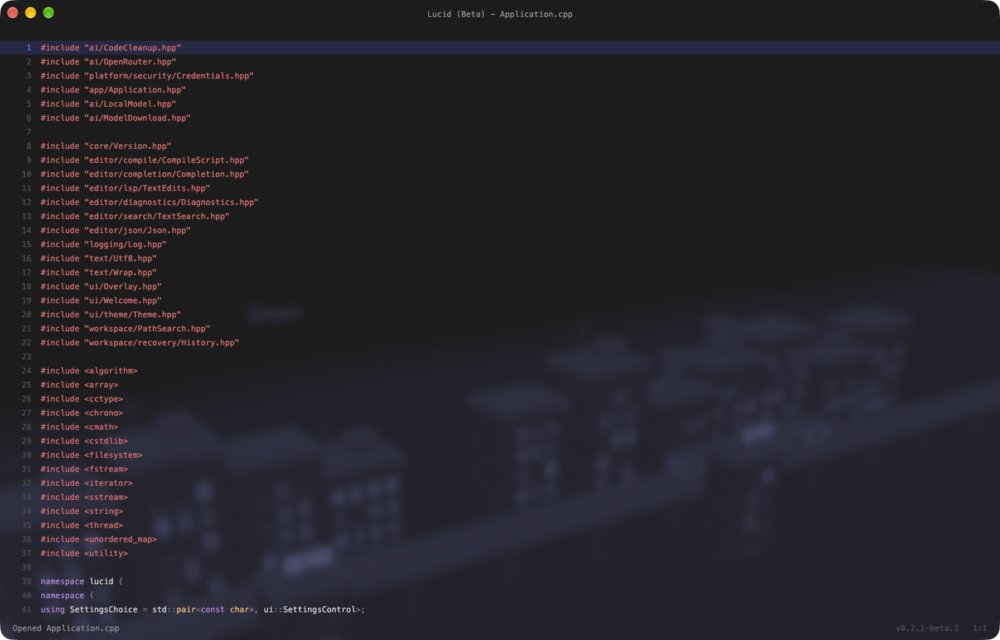
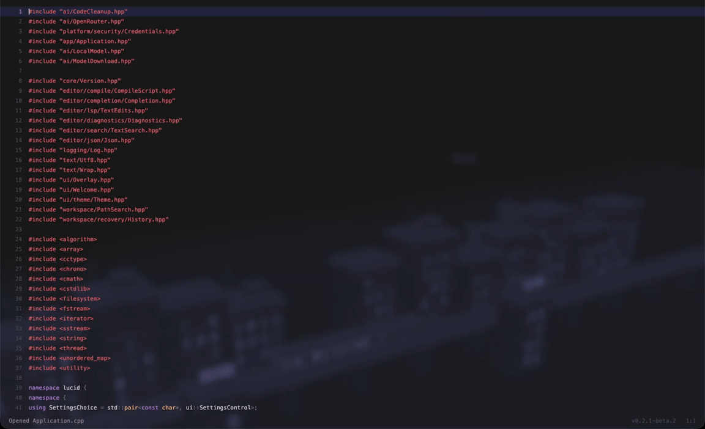
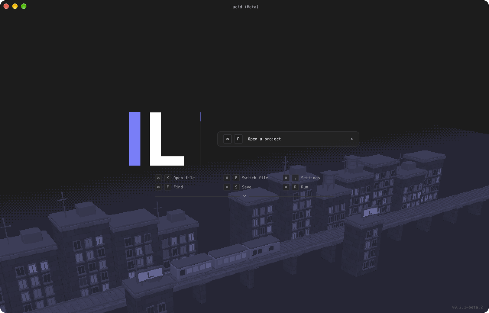

# Lucid

**A minimal, GPU-accelerated code editor built on Vulkan.**

Keyboard-first. Path-native. Drawn entirely on the GPU.

[Download the beta](https://github.com/initializeddd/Lucid/releases){ .md-button .md-button--primary }
[Get started](getting-started.md){ .md-button }
[View on GitHub](https://github.com/initializeddd/Lucid){ .md-button }

!!! warning "Beta software"
    Lucid is in beta. File formats and behavior may change between releases. See the
    [changelog](https://github.com/initializeddd/Lucid/blob/main/CHANGELOG.md) and
    [roadmap](roadmap.md).

## Why Lucid

- :material-keyboard: **Keyboard-first**

    Open projects, files and folders by typing where they live. No permanent file tree and no
    permanent tab bar in the way.

- :material-file-tree: **Path-native**

    The workspace is built around paths rather than a tree. Create folders by typing a trailing
    slash, and switch open files without leaving the canvas.

- :material-gpu: **GPU-rendered**

    The window, text, chrome and overlays are drawn by a small Vulkan renderer. macOS runs on
    MoltenVK; Windows and Linux use the native Vulkan loader.

- :material-magnify: **Project search**

    Search project files with `Ctrl+Shift+F` (`Command+Shift+F` on macOS) and review replacements
    before applying them.

- :material-hammer-wrench: **Comment-driven builds**

    Define compile functions next to the code that describes them and run them in an attached
    terminal.

- :material-robot: **Optional local AI**

    Review a suggestion before applying it. The model is downloaded and verified on first use.

## See it in action

A short [MP4 version](assets/screenshots/demo.mp4) is available for reduced-motion or
lower-bandwidth viewing.

## Install

Download the latest beta from the
[releases page](https://github.com/initializeddd/Lucid/releases).

| Platform | Artifacts | Notes |
| --- | --- | --- |
| macOS | DMG and standalone ZIP | Ad-hoc signed, not notarized |
| Linux | Standalone archive and installer script | A working Vulkan driver is required |
| Windows | MSI and standalone ZIP | MSI requires administrator access |
| FreeBSD and OpenBSD | Standalone archives | Install GLFW, Vulkan and system crypto libraries |

The release includes SHA-256 checksums. Beta builds are not signed with distribution certificates,
so macOS Gatekeeper and Windows SmartScreen may warn on first launch.

## Documentation

- [Getting started](getting-started.md) — install Lucid and open your first project.
- [Building](building.md) — build from source on macOS, Linux, Windows and BSD.
- [Architecture](architecture.md) — how the editor, renderer and workspace fit together.
- [Modules](modules.md) — declarative text commands.
- [Roadmap](roadmap.md) — what is planned and what is still missing.

## Community

- [GitHub Discussions](https://github.com/initializeddd/Lucid/discussions) for questions and ideas.
- [Issues](https://github.com/initializeddd/Lucid/issues) for reproducible bugs and scoped feature
  requests.
- [Contributing](https://github.com/initializeddd/Lucid/blob/main/CONTRIBUTING.md) before opening a
  pull request.
- [Security policy](https://github.com/initializeddd/Lucid/blob/main/SECURITY.md) for vulnerability
  reports.

Lucid is released under the [MIT License](https://github.com/initializeddd/Lucid/blob/main/LICENSE).
